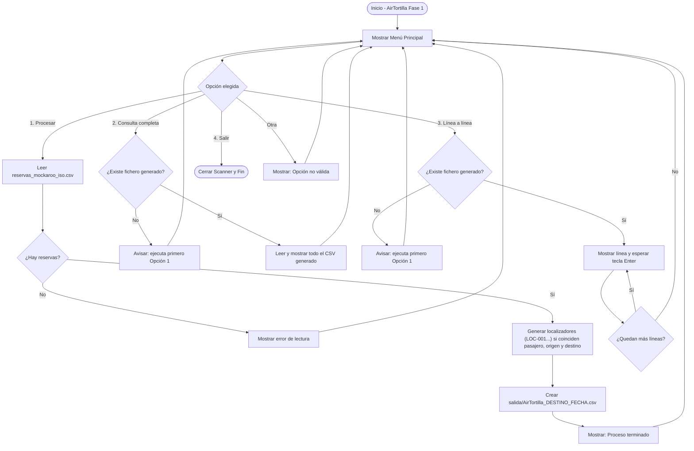

AirTortilla - Procesador Inteligente de Reservas 
Proyecto desarrollado en Java y JavaScript diseñado para procesar, gestionar y generar localizadores de reservas de vuelos a partir de archivos de texto estructurados en formato CSV. El sistema cuenta tanto con una arquitectura orientada a consola/lógica en Java como con un procesador web interactivo.

Características Principales
Lectura y Procesamiento de Ficheros CSV: Importación automática de datos de pasajeros (origen, destino, nombre y fecha).

Generación Automática de Localizadores: Algoritmo inteligente que detecta coincidencias de pasajeros recurrentes y les asigna un identificador único de reserva (LOC-001, LOC-002, etc.).

Exportación Organizada: Guarda los resultados procesados en la carpeta salida/ utilizando una nomenclatura estandarizada (AirTortilla_[DESTINO]_[FECHA].csv).

Visualización Dual: Permite consultar los resultados procesados de forma completa o de manera interactiva (línea por línea).

Versión Web Interactiva: Interfaz en HTML5 y JavaScript puro para ejecutar todo el flujo directamente desde el navegador web.

Estructura del Código
El proyecto está compuesto por los siguientes módulos principales:

Reserva.java: Modelo de datos que representa una reserva individual. Contiene los atributos de la ruta, pasajero, fecha y el código localizador, además de la lógica para comparar pasajeros (coincidePasajero).

GestorReservas.java: Gestiona la lógica de negocio, lectura del fichero original, aplicación del algoritmo de localizadores, creación de ficheros de salida y métodos de consulta por consola.

index.html: Interfaz web visual con diseño moderno que replica la lógica de procesamiento en el navegador utilizando JavaScript.

Tecnologías Utilizadas
Java (Lectura de ficheros mediante BufferedReader, PrintWriter, colecciones ArrayList).

HTML5 & CSS3 (Diseño de la interfaz web moderna con variables CSS y diseño adaptativo).

JavaScript (ES6+) (FileReader, manipulación del DOM y lógica de filtrado de datos).

# ✈️ AirTortilla - Procesador Inteligente de Reservas

Proyecto desarrollado en Java y JavaScript diseñado para procesar, gestionar y generar localizadores de reservas de vuelos a partir de archivos de texto estructurados en formato CSV, evolucionando en su segunda fase hacia una aplicación web completa respaldada por una **Base de Datos Relacional** y desplegada mediante **contenedores Docker**.

---

## 📦 Fase 1: Gestión con Ficheros CSV (Versión Inicial)

En la primera entrega, el sistema contaba tanto con una arquitectura orientada a consola/lógica en Java como con un procesador web interactivo basado en ficheros locales.

### Características Principales (Fase 1)
- **Lectura y Procesamiento de Ficheros CSV:** Importación automática de datos de pasajeros (origen, destino, nombre y fecha).
- **Generación Automática de Localizadores:** Algoritmo inteligente que detecta coincidencias de pasajeros recurrentes y les asigna un identificador único de reserva (`LOC-001`, `LOC-002`, etc.).
- **Exportación Organizada:** Guarda los resultados procesados en la carpeta `salida/` utilizando una nomenclatura estandarizada (`AirTortilla_[DESTINO]_[FECHA].csv`).
- **Visualización Dual:** Permite consultar los resultados procesados de forma completa o de manera interactiva (línea por línea).
- **Versión Web Interactiva:** Interfaz en HTML5 y JavaScript puro para ejecutar todo el flujo directamente desde el navegador web.

### Estructura del Código (Fase 1)
- `Reserva.java`: Modelo de datos que representa una reserva individual. Contiene los atributos de la ruta, pasajero, fecha y el código localizador, además de la lógica para comparar pasajeros (`coincidePasajero`).
- `GestorReservas.java`: Gestiona la lógica de negocio, lectura del fichero original, aplicación del algoritmo de localizadores, creación de ficheros de salida y métodos de consulta por consola.
- `index.html`: Interfaz web visual con diseño moderno que replica la lógica de procesamiento en el navegador utilizando JavaScript.

### Tecnologías Utilizadas (Fase 1)
- **Java:** Lectura de ficheros mediante `BufferedReader`, `PrintWriter`, colecciones `ArrayList`.
- **HTML5 & CSS3:** Diseño de la interfaz web moderna con variables CSS y diseño adaptativo.
- **JavaScript (ES6+):** `FileReader`, manipulación del DOM y lógica de filtrado de datos.

---

## 🚀 Fase 2: Migración a Base de Datos Relacional, Seguridad y Docker

En esta segunda entrega, AirTortilla migra su infraestructura de almacenamiento en ficheros planos a una **Base de Datos Relacional (H2)**, incorpora **autenticación por roles**, **alta de usuarios**, **trazabilidad (auditoría)** y **despliegue en contenedores Docker**, unificando la aplicación en una arquitectura Cliente-Servidor web con **Javalin**.

### 📋 User Stories y Desglose en Tareas Medibles

| User Story / Requisito | Tareas Medibles | Estado |
|---|---|---|
| **US1:** Como Empleado quiero poder hacer login para acceder a los recursos de la compañía | - Diseñar e inicializar tabla `usuarios` con roles (`ADMIN` / `EMPLEADO`).<br>- Implementar `AuthService.login()` con validación JDBC.<br>- Crear endpoint `POST /api/login` y pantalla `login.html`.<br>- Bloquear el acceso a `index.html` si no hay sesión iniciada y gestionar cierre de sesión. | ✅ Completado |
| **US2:** Como Administrador de Sistemas quiero poder dar de alta usuarios para garantizar la seguridad interna | - Implementar `UsuarioService` (`crearUsuario` y `listarUsuarios`).<br>- Exponer endpoints `POST /api/usuarios` y `GET /api/usuarios`.<br>- Añadir pestaña **Usuarios** en el dashboard visible únicamente para rol `ADMIN`. | ✅ Completado |
| **US3:** Como Administrador de Sistemas quiero mantener la trazabilidad de las modificaciones | - Diseñar tabla `auditoria` con usuario, acción, detalle y fecha/hora automática.<br>- Implementar `AuditoriaService` registrando eventos clave (`LOGIN`, `LOGIN_FALLIDO`, `MIGRAR_CSV`, `CONSULTA_RESERVAS`, `ALTA_USUARIO`, `CONSULTA_AUDITORIA`).<br>- Exponer `GET /api/auditoria` y crear pestaña **Auditoría** visible solo para `ADMIN`. | ✅ Completado |
| **Migración a Base de Datos Relacional** | - Configurar driver JDBC y conexión centralizada (`ConexionBD.java`) + creación automática de esquema (`DatabaseSetup.java`).<br>- Adaptar `GestorReservas.java` para saltar la cabecera del CSV, generar localizadores y migrar las 1000 reservas por lotes (`executeBatch`) a la tabla `reservas`.<br>- Sustituir la consulta desde fichero por consultas SQL (`GET /api/reservas`). | ✅ Completado |
| **Contenedores Virtuales (Bonus)** | - Configurar `maven-shade-plugin` para generar un fat JAR ejecutable (`app-fat.jar`).<br>- Crear `Dockerfile` multi-stage (Maven + Eclipse Temurin 21 JRE).<br>- Crear `docker-compose.yaml` con mapeo de puerto `7000` y volumen persistente para la BD (`/app/data`). | ✅ Completado |

---

### 🔄 Evolución y Migración del Stack Tecnológico

Siguiendo las directrices del proyecto, se documentan los cambios realizados en el stack al pasar de la Fase 1 a la Fase 2:

| Capa | Fase 1 | Fase 2 (Actual) | Motivo del cambio |
|---|---|---|---|
| **Backend / Servidor** | Aplicación de consola (`Scanner`) | **Java 21 + Javalin 6.1.3** (API REST) + **Jackson 2.17.1** | Conectar la lógica Java directamente con la interfaz web vía HTTP/JSON. |
| **Persistencia de Datos** | Ficheros planos CSV (`salida/*.csv`) | **Base de Datos Relacional H2 (2.2.224)** vía JDBC | Cumplimiento legislativo, integridad referencial, consultas rápidas y soporte para usuarios/auditoría. |
| **Frontend** | `index.html` aislado procesando en cliente | **`login.html` + `index.html`** servidos desde `src/main/resources/public/` | Autenticación real contra backend, control de roles y dashboard con pestañas (Reservas, Usuarios, Auditoría). |
| **Empaquetado y Despliegue** | Ejecución local desde IDE | **Maven Shade Plugin + Docker & Docker Compose** | Despliegue reproducible y portable con un único comando y persistencia en volumen Docker. |

---

### 🗄️ Modelo de Base de Datos Relacional

Al arrancar la aplicación, `DatabaseSetup.java` crea automáticamente las siguientes tablas en `./data/airtortilla_db` junto con un usuario administrador por defecto:

- **`usuarios`**: `id` (PK), `username` (UNIQUE), `password`, `rol` (`ADMIN` / `EMPLEADO`), `activo`, `fecha_creacion`.
- **`reservas`**: `id` (PK), `destino`, `origen`, `nombre_pasajero`, `fecha`, `localizador`.
- **`auditoria`**: `id` (PK), `usuario`, `accion`, `detalle`, `fecha_hora`.

---

### 🔌 Endpoints de la API REST

| Método | Ruta | Descripción |
|---|---|---|
| `POST` | `/api/login` | Autentica al usuario contra la BD y devuelve su rol (`200` / `401`). |
| `POST` | `/api/reservas/procesar` | Lee `reservas_mockaroo_iso.csv`, genera localizadores y migra las 1000 reservas a la BD. |
| `GET` | `/api/reservas` | Devuelve todas las reservas almacenadas en la BD relacional en formato JSON. |
| `POST` | `/api/usuarios` | Da de alta un nuevo usuario (`EMPLEADO` o `ADMIN`) y lo registra en auditoría. |
| `GET` | `/api/usuarios` | Lista todos los usuarios registrados. |
| `GET` | `/api/auditoria` | Devuelve el historial completo de trazabilidad ordenado por fecha descendente. |

---

### 📂 Estructura Actual del Proyecto

```text
Entrega-Proyecto-Fichero/
├── pom.xml                                  # Dependencias (Javalin, Jackson, H2) y Maven Shade Plugin
├── Dockerfile                               # Build multi-stage (Maven + Temurin 21 JRE)
├── docker-compose.yaml                      # Servicio airtortilla-app + volumen persistente db-data
├── reservas_mockaroo_iso.csv                # Dataset original de 1000 reservas
└── src/main/
    ├── java/
    │   ├── Main.java                        # Servidor Javalin y definición de endpoints REST
    │   ├── ConexionBD.java                  # Gestión de conexión JDBC a H2 (./data/airtortilla_db)
    │   ├── DatabaseSetup.java               # Inicialización automática de tablas y usuario admin
    │   ├── AuthService.java                 # Lógica de autenticación y registro de accesos
    │   ├── UsuarioService.java              # Alta y listado de usuarios
    │   ├── AuditoriaService.java            # Registro y consulta de trazabilidad
    │   ├── GestorReservas.java              # Lectura CSV, localizadores, migración y consulta BD
    │   └── Reserva.java                     # Modelo de entidad Reserva
    └── resources/public/
        ├── login.html                       # Pantalla de inicio de sesión
        └── index.html                       # Dashboard web (Reservas, Usuarios, Auditoría)
```

---

### 🐳 Despliegue y Ejecución

#### Opción 1: Con Docker (Recomendado)
Requiere tener **Docker Desktop** instalado. Desde la raíz del proyecto ejecuta:

```bash
docker compose up --build
```

Para detener el contenedor (manteniendo los datos guardados en el volumen):
```bash
docker compose down
```

Para reiniciar limpiando también la base de datos:
```bash
docker compose down -v
docker compose build --no-cache
docker compose up
```

#### Opción 2: Sin Docker (Maven / IDE)
1. Asegúrate de tener **Java 21** y **Maven** configurados.
2. Ejecuta `Main.java` desde IntelliJ IDEA (o compila con `mvn clean package -DskipTests` y lanza `java -jar target/app-fat.jar`).

---

### 🌐 Acceso a la Aplicación

Una vez levantado el servidor, abre en el navegador:
- **URL de acceso:** `http://localhost:7000/login.html`
- **Credenciales por defecto (Administrador):**
  - **Usuario:** `admin`
  - **Contraseña:** `admin123`

Desde la cuenta `admin` podrás migrar las 1000 reservas del CSV a la base de datos, consultar los registros (modo completo o línea a línea), dar de alta nuevos empleados y revisar toda la actividad en la pestaña de **Auditoría**.

### 📊 Diagrama de Flujo (Fase 1)


